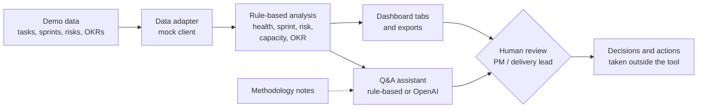
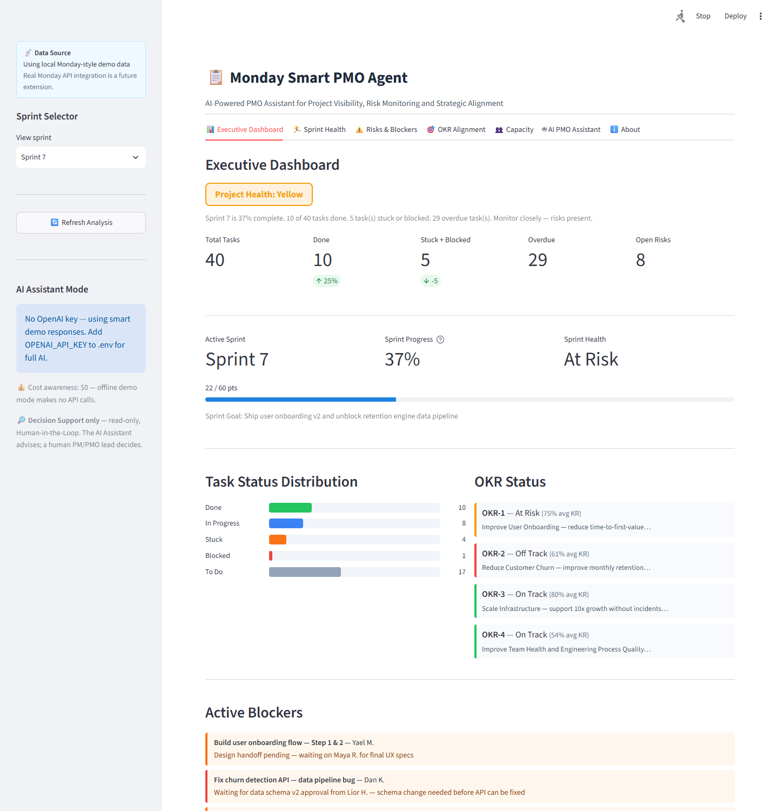
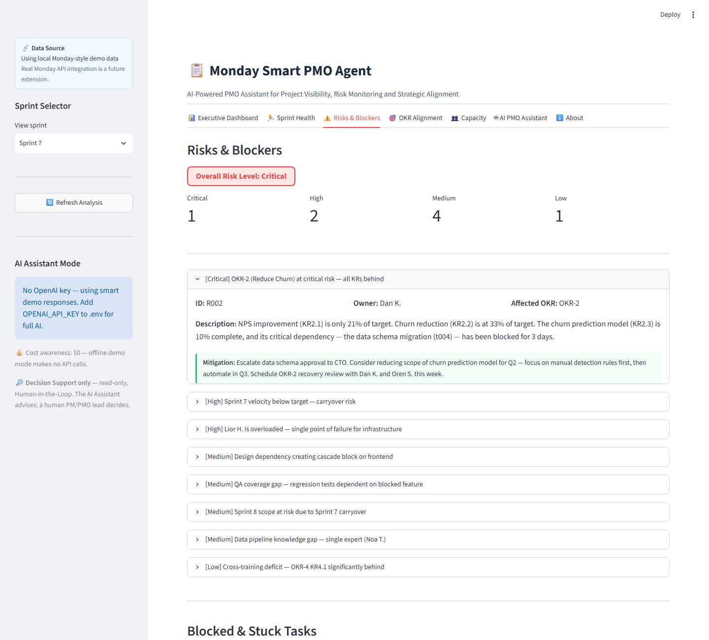

# Monday Smart PMO Agent

**Oren Salami** · Category: **Project Planning & Delivery**

A local decision-support tool that reads Monday-style project data and turns it into a
delivery picture: project health, sprint progress, risks and blockers, team load, and
OKR alignment — plus a Q&A assistant for plain-language questions. It suggests; a person
decides.

> **Status:** completed demo/portfolio project. It runs offline on fictional demo data.
> Live Monday integration is a planned extension, not a working feature.

---

## Why This Project

Delivery problems usually show up in the data before anyone names them: a sprint that is
behind plan, a blocked task holding up an objective, one person carrying too much work.
This project shows how those signals can be pulled together into one view so the people
planning and monitoring the work see them early — without handing decisions to a tool.

## What It Does

| Area | What you get |
|------|--------------|
| Project health | Green / Yellow / Red score, status counts, overdue tasks, active blockers |
| Sprint monitoring | Progress vs. plan, sprint health, carryover risk, retrospective talking points |
| Risk visibility | Risk register sorted by severity, with mitigations and affected OKRs |
| Team load | Per-person tasks and points, overload and workload-concentration flags |
| OKR alignment | Key-result progress, at-risk objectives, unaligned work, blocked work threatening an OKR |
| Q&A assistant | Answers questions from the analysis results — rule-based by default, OpenAI optional |
| Exports | Health report (`.md`), sprint summary (`.csv`), risk register (`.csv`) |

What is working, mocked, optional, or planned: [Project Overview](docs/PROJECT_OVERVIEW.md)
and [Integration Status](docs/ARCHITECTURE.md#integration-status).

## How It Works



All scores come from fixed, unit-tested Python rules. The assistant only explains those
results; it cannot change them. Details: [Architecture](docs/ARCHITECTURE.md).

## Project in Pictures

**Application screenshots** — captured from the local Streamlit app in demo mode
(fictional data):


*Executive Dashboard: overall health, sprint progress, task status, OKR status, and active blockers.*


*Risks & Blockers: severity counts and the risk register, with the critical OKR-2 risk expanded.*

**External-service screenshots** — a Monday.com board used to plan and track the work of
building this project. The app does not read this board.


*Monday.com: sprint groups for this project's own build tasks.*


*Monday.com: backlog of assistant and reporting tasks.*

## Example Workflow

Using the bundled demo data (fictional company TechCo, 40 tasks, 4 sprints, 8 risks, 4 OKRs):

1. **Check health** — the dashboard shows **Yellow**: Sprint 7 is 37% complete (22 of 60
   points) and 5 tasks are stuck or blocked.
2. **Look at the sprint** — Sprint Health rates Sprint 7 **At Risk** and lists retro talking points.
3. **Review risks** — overall risk level is **Critical**; the top item is OKR-2 (Reduce
   Churn), whose key dependency has been blocked for 3 days.
4. **Check alignment** — OKR-1 and OKR-2 are at risk, and both have blocked or stuck
   contributing work; about 17% of active work is not linked to an OKR.
5. **Check team load** — Dan K. and Lior H. are flagged as overloaded.
6. **Ask and export** — ask "What should I focus on this week?", then export the health report.
7. **Decide** — the reviewer decides what to escalate, re-plan, or reassign.

Overdue counts are calculated against today's date, so with this static data they rise over
time. More scenarios: [Demo and Operations](docs/DEMO_AND_OPERATIONS.md#demo-scenarios).

## Architecture at a Glance

| Layer | Location |
|-------|----------|
| Data adapter (mock active, Monday API placeholder) | `src/integrations/` |
| Analysis rules | `src/pmo/`, `src/risk/`, `src/okr/` |
| Context and exports | `src/reporting/` |
| Q&A pipeline (retrieval over methodology notes) | `src/pipeline/` |
| UI (7 tabs) | `app/streamlit_app.py` |

Python 3.11 · Streamlit · ChromaDB · Pydantic Settings. See [Architecture](docs/ARCHITECTURE.md).

## Run Locally

```bash
git clone https://github.com/Oren1984/Monday-Smart-PMO-Agent.git
cd Monday-Smart-PMO-Agent
python -m venv .venv
.venv\Scripts\activate          # Windows
# source .venv/bin/activate     # macOS / Linux
pip install -r requirements.txt
cp .env.example .env
streamlit run app/streamlit_app.py
```

Open http://localhost:8501. No API key or Monday account is needed.

With Docker (after creating `.env`): `docker compose up --build`, then open http://localhost:8511.

Configuration and troubleshooting: [Demo and Operations](docs/DEMO_AND_OPERATIONS.md).

## Human Review & Boundaries

- Read-only: the tool never changes tasks, statuses, or Monday data.
- Advisory: it flags and suggests; it does not approve, escalate, or reassign anything.
- Every decision, escalation, and re-plan is made by a person.
- Credentials come only from environment variables; `.env` is not committed.
- Not included: live Monday sync, multi-user access, cloud deployment, or production hardening.

Full detail: [Governance and Validation](docs/GOVERNANCE_AND_VALIDATION.md).

## Documentation & Validation

| Document | Covers |
|----------|--------|
| [Project Overview](docs/PROJECT_OVERVIEW.md) | Problem, purpose, capabilities, workflow, example |
| [Architecture](docs/ARCHITECTURE.md) | Components, data flow, rules, integration status |
| [Demo and Operations](docs/DEMO_AND_OPERATIONS.md) | Setup, configuration, demo scenarios, troubleshooting |
| [Governance and Validation](docs/GOVERNANCE_AND_VALIDATION.md) | Oversight, security, testing, limitations, future work |

`pytest` runs 73 unit, integration, and end-to-end tests offline in mock mode.
