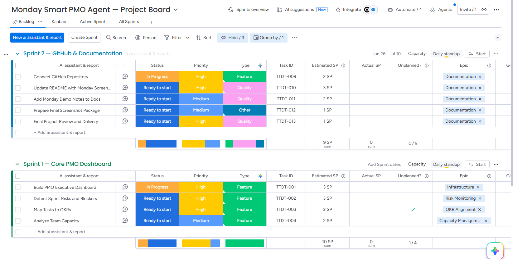
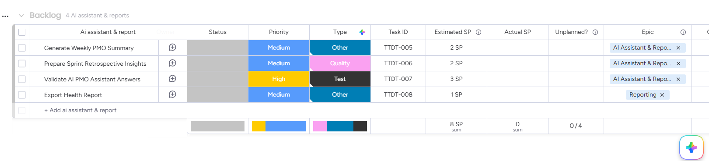

# Monday Smart PMO Agent

**Oren Salami | Technology Project Management + AI Tools**

AI-Powered PMO Assistant for Project Visibility, Risk Monitoring and Strategic Alignment.

---

## Project Overview

The **Monday Smart PMO Agent** connects to Monday-style project data and answers the questions every PM and PMO stakeholder needs answered:

- What is the current portfolio status?
- Which tasks are blocking the sprint?
- Which OKRs are at risk?
- Who is overloaded on the team?
- What should I focus on this week?
- What should we discuss in the retrospective?

This is not a generic chatbot. It is a purpose-built PMO assistant grounded in real Agile, Scrum, Sprint Ops, OKR, and capacity management methodology.

---

## Monday Integration

**Current version uses realistic local Monday-style demo data.**

The architecture includes a clean adapter layer (`src/integrations/`) that decouples the data source from the analysis engine. Switching from demo data to a live Monday workspace requires only one configuration change:

```
PMO_DATA_SOURCE=monday_api
```

No other code changes are required. See `docs/architecture.md` for the full design.

> This project currently uses realistic Monday-style mock data instead of a live Monday account.
> The architecture is intentionally prepared for future Monday API integration through an adapter/client layer.
> This keeps the project lightweight while still demonstrating real PMO integration thinking.

---

## Monday Demo Environment

A real Monday.com account was created for demo validation and environment readiness.

**Board created:** Monday Smart PMO Agent — Project Board

| Group | Contents |
|-------|---------|
| Sprint 1 — Core PMO Dashboard | Core dashboard tasks |
| Backlog | AI Assistant & Reports tasks |
| Sprint 2 — GitHub & Documentation | Documentation tasks |

Screenshots of the board are available under `docs/screenshots/`:

**Sprint Overview:**



**AI Reports Backlog:**



> The real Monday board validates that the project is structurally ready for live Monday API integration.
> The Streamlit app continues to run in mock/demo mode — no Monday account is needed to run the project.

---

## Core Capabilities

| Capability | Input | Output |
|-----------|-------|--------|
| **Portfolio Visibility** | Tasks, sprints, statuses, due dates | Health score, blockers, sprint progress |
| **Risk Monitoring** | Blocked tasks, OKR gaps, capacity signals | Risk registry with severities and mitigations |
| **Sprint Insights** | Sprint tasks, velocity, team distribution | Sprint health, retro talking points, bottlenecks |
| **OKR Alignment** | Tasks with OKR links, OKR registry | At-risk objectives, unaligned work percentage |
| **Executive Summary** | Portfolio-wide health, risks, OKRs | PMO-level summary with recommended actions |
| **AI PMO Q&A** | Natural language question + project context | Contextual PM answer with methodology grounding |

---

## Human-in-the-Loop

The Monday Smart PMO Agent supports PMO decision-making but does not replace human judgment.

The agent detects risks, summarizes information, highlights gaps, and suggests actions. A human PM, PMO lead, or engineering manager must approve decisions, escalations, reprioritization, and delivery changes.

| The agent DOES | The agent does NOT |
|---------------|-------------------|
| Detect risk signals | Make delivery decisions |
| Summarize sprint status | Approve or reject work |
| Highlight OKR gaps | Replace the PM or PMO role |
| Suggest follow-up actions | Automatically escalate issues |
| Surface team overload | Reassign tasks autonomously |

See `docs/AI_GOVERNANCE_AND_RISK_PRINCIPLES.md` for the full governance principles.

---

## Architecture

```
data/monday_demo/*.json
        ↓
src/integrations/monday_mock_client.py  ← Active (adapter pattern)
src/integrations/monday_api_client.py   ← Future skeleton (env-var driven)
        ↓
src/pmo/  src/risk/  src/okr/  src/reporting/
        ↓
src/pipeline/pmo_pipeline.py  ←  RAG + AI Q&A layer
        ↓
app/streamlit_app.py  ← 7-tab PMO dashboard
```

---

## Security Note

- `.env` is **never committed** — it is listed in `.gitignore`
- `.env.example` contains only safe placeholders (no tokens, no credentials)
- `MONDAY_API_TOKEN`, `OPENAI_API_KEY`, and `GEMINI_API_KEY` must never be hardcoded in source files
- All API keys and credentials are read from environment variables at runtime only
- The default mode (`PMO_DATA_SOURCE=mock`) requires no credentials of any kind

---

## How to Run

**Clone and install:**
```bash
git clone https://github.com/Oren1984/smart-pmo-agent.git
cd smart-pmo-agent
python -m venv .venv
.venv\Scripts\activate        # Windows
# source .venv/bin/activate     # macOS / Linux
pip install -r requirements.txt
cp .env.example .env
```

**Run the Streamlit UI:**
```bash
streamlit run app/streamlit_app.py
```

Open: http://localhost:8511

No API key, Monday account, or external service is required.

**Run with Docker:**
```bash
docker compose up --build
```

Open: http://localhost:8511

---

## Streamlit UI Tabs

| Tab | Contents | Export |
|-----|---------|--------|
| Executive Dashboard | Health score, status distribution, sprint progress, OKR summary, blockers | Health Report (.md) |
| Sprint Health | Velocity, task breakdown, team load, retro talking points | Sprint Summary (.csv) |
| Risks & Blockers | Risk registry by severity, blocked task detail table | Risk Registry (.csv) |
| OKR Alignment | Per-OKR KR progress, contributing tasks, unaligned work | — |
| Capacity / Workload | Per-owner task and point distribution, overload detection | — |
| AI PMO Assistant | Natural language Q&A — demo mode (no key) or OpenAI | — |
| About | Project explanation, architecture, demo guide | — |

---

## AI PMO Assistant

The AI assistant works in two modes:

| Mode | When | Quality |
|------|------|---------|
| **Demo mode** (default) | No OpenAI key — fully offline | Smart rule-based answers from live project data |
| **AI mode** | `OPENAI_API_KEY` set in `.env` | Full AI answers grounded in methodology docs + project data |

Both modes answer questions about project status, blockers, OKRs, capacity, sprint health, and retrospective preparation.

---

## Tech Stack

| Layer | Technology |
|-------|-----------|
| UI | Streamlit |
| Integration | Adapter pattern (mock / Monday API) |
| PMO Analysis | Python (custom engine) |
| AI Q&A | RAG — ChromaDB + OpenAI / rule-based |
| Embeddings | Mock (default) · HuggingFace · OpenAI |
| Vector Store | ChromaDB |
| Config | Pydantic Settings + python-dotenv |
| Packaging | Docker + Docker Compose |
| Language | Python 3.11 |

---

## Demo Data

The project ships with a realistic Monday-style demo dataset for a fictional company **TechCo** building a SaaS product **FlowHQ**:

| Entity | Count | Details |
|--------|-------|---------|
| Boards | 2 | Product Development, Platform & Infrastructure |
| Tasks | 40 | Across 4 sprints + backlog, 8 team members, 4 OKRs |
| Sprints | 4 | Sprints 5–8 (1 active, 2 completed, 1 planned) |
| OKRs | 4 | Onboarding (At Risk), Churn (Off Track), Infrastructure (On Track), Team Health (On Track) |
| Risks | 8 | 1 Critical, 3 High, 3 Medium, 1 Low |
| Team | 8 | Yael M., Dan K., Oren S., Maya R., Lior H., Tali G., Ron A., Noa T. |

All data is local, fictional, and requires no account or internet connection.

---

## Export Reports

Three export options are available directly from the Streamlit dashboard:

| Export | Tab | Format |
|--------|-----|--------|
| Project Health Report | Executive Dashboard | Markdown (.md) |
| Sprint Summary | Sprint Health | CSV (.csv) |
| Risk Registry | Risks & Blockers | CSV (.csv) |

All exports are local — no data leaves your machine.

---

## Running Tests

```bash
pytest                          # full suite (59 tests)
pytest tests/unit/              # unit tests only
pytest tests/integration/       # integration tests
pytest tests/e2e/               # end-to-end flow
pytest --cov=src                # with coverage
```

All tests run in mock mode — no API key or Monday account required.

---

## Static Portfolio Site

```bash
cd static-site
python -m http.server 8000
```

Open: http://localhost:8000

---

## Project Structure

```
Monday-Smart-PMO-Agent/
├── app/streamlit_app.py          # Main UI (7-tab Streamlit dashboard)
├── src/
│   ├── core/                     # Config, contracts, exceptions
│   ├── integrations/             # Monday adapter layer (mock + future API)
│   ├── pmo/                      # PMO analysis engine
│   ├── risk/                     # Risk detection
│   ├── okr/                      # OKR alignment analysis
│   ├── pipeline/                 # RAG / AI Q&A pipeline
│   ├── reporting/                # Exports and report building
│   └── observability/            # Metrics and tracing
├── data/
│   ├── monday_demo/              # Local JSON demo data (40 tasks, 4 OKRs, 8 risks)
│   └── methodology_docs/         # PM methodology knowledge base (Agile, OKR, etc.)
├── docs/                         # Architecture, governance, demo scripts, scenarios
├── static-site/                  # Portfolio landing page (HTML/CSS/JS)
└── tests/                        # Unit, integration, e2e test suite
```

---

## Documentation

| Document | Contents |
|----------|---------|
| `docs/architecture.md` | System design and data flow |
| `docs/AI_GOVERNANCE_AND_RISK_PRINCIPLES.md` | AI governance, Human-in-the-Loop, responsible use |
| `docs/EXAMPLE_EVALUATION_SCENARIOS.md` | Demo and evaluation scenarios |
| `docs/methodology_alignment.md` | Agile, Scrum, OKR, sprint ops mapping |
| `docs/demo_flow.md` | How to demo and present the project |
| `docs/testing_strategy.md` | Testing approach and coverage |
| `docs/known_limitations.md` | What is demo data, what is not, what is next |
| `docs/API_KEYS_GUIDE.md` | Setup guide for all configuration options |
| `docs/security_observability.md` | Security modules and observability layer |

---

## What This Project Intentionally Does NOT Include

This project is intentionally right-sized for a demo-ready PMO assistant. The following are excluded by design:

- **No real MCP implementation** — no Model Context Protocol server at this stage
- **No multi-agent architecture** — a single AI assistant is sufficient for this scope
- **No production cloud deployment** — demo mode runs locally with no cloud dependencies
- **No automatic decision-making** — human approval is always required for escalations and changes
- **No heavy security framework** — appropriate governance is noted in docs; production hardening is future work
- **No unnecessary CI/CD** — tests run locally; a CI pipeline is a future extension
- **No replacement for PM/PMO human judgment** — the agent assists, it does not decide

---

## Project Category

**Technology Project Management + AI Tools**

This project demonstrates practical AI application for project management — not pure AI/ML engineering. It shows how to build a PMO assistant that helps a PM improve portfolio visibility, detect risks earlier, align work to strategic goals, and answer natural language questions about project status.

---

## Responsible AI Statement

The Monday Smart PMO Agent supports PMO decisions — it does not replace human judgment.

The agent detects signals, summarizes data, and suggests actions. A qualified PM, PMO lead, or engineering manager must review, validate, and approve all decisions before acting. No escalation, reprioritization, or delivery change should be made based solely on agent output without human review.

See `docs/AI_GOVERNANCE_AND_RISK_PRINCIPLES.md` for the full governance and Human-in-the-Loop principles.

---

## License

MIT License. See the LICENSE file for details.
