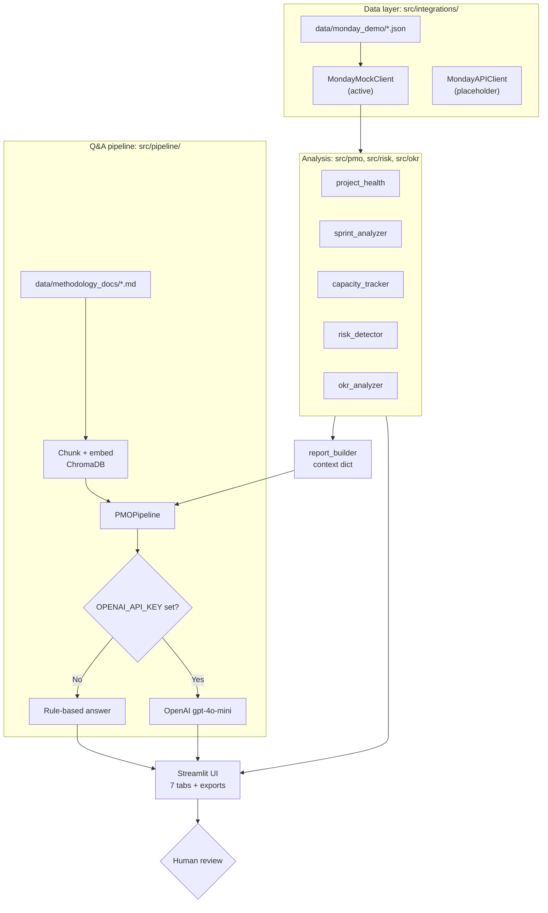

# Architecture

A single Python application with four layers: a data adapter, rule-based analysis
modules, an optional Q&A pipeline, and a Streamlit user interface. Layers communicate
through typed dataclasses defined in `src/core/contracts.py`.

---

## Architecture Diagram

## Components

| Component | Location | Role |
|-----------|----------|------|
| Data contracts | `src/core/contracts.py` | Dataclasses for tasks, sprints, risks, OKRs, reports, and answers; abstract `MondayClientBase` |
| Configuration | `src/core/config.py` | Pydantic Settings, read from environment variables and `.env` |
| Client factory | `src/integrations/__init__.py` | `get_monday_client()` selects the client from `PMO_DATA_SOURCE` |
| Mock client | `src/integrations/monday_mock_client.py` | Loads and normalises the local demo JSON |
| API client | `src/integrations/monday_api_client.py` | Placeholder for the Monday API; every data method raises `NotImplementedError` |
| Project health | `src/pmo/project_health.py` | Health score, status counts, overdue tasks, blockers |
| Sprint analysis | `src/pmo/sprint_analyzer.py` | Progress vs. plan, sprint health, team points, bottlenecks, retro points |
| Capacity | `src/pmo/capacity_tracker.py` | Per-owner active tasks and points, overload, workload concentration |
| Risks | `src/risk/risk_detector.py` | Filters open risks, sorts by severity, reports the highest level |
| OKR alignment | `src/okr/okr_analyzer.py` | Task-to-OKR mapping, unaligned work, at-risk OKRs with blocked work |
| Reporting | `src/reporting/report_builder.py`, `export.py` | Context dictionary for Q&A; Markdown and CSV exports |
| Q&A pipeline | `src/pipeline/pmo_pipeline.py` | Methodology retrieval and answer generation |
| Supporting modules | `src/ingestion/`, `src/chunking/`, `src/embeddings/`, `src/vectorstores/` | Document loading, chunking, embeddings, vector storage for the Q&A pipeline |
| Observability | `src/observability/` | In-memory counters and timers (not shown in the UI) |
| UI | `app/streamlit_app.py` | Seven tabs: Executive Dashboard, Sprint Health, Risks & Blockers, OKR Alignment, Capacity, AI PMO Assistant, About |

## Technologies

| Area | Technology |
|------|-----------|
| Language | Python (Docker image: 3.11) |
| UI | Streamlit |
| Configuration | pydantic-settings, python-dotenv |
| Data handling | pandas, numpy |
| Vector store | ChromaDB (local, under `vector_db/chroma`) |
| Embeddings | Mock hash-based (default); HuggingFace sentence-transformers or OpenAI (optional) |
| Answer generation | Rule-based (default); OpenAI `gpt-4o-mini` (optional) |
| Packaging | Docker, Docker Compose |
| Tests | pytest, pytest-cov |

## Data Flow

1. **Load**: `get_monday_client()` returns the mock client; the app loads boards, tasks,
   sprints, risks, and OKRs once per session (`st.cache_data`).
2. **Analyse**: the app picks the active sprint (or the one chosen in the sidebar) and runs
   the five analysis modules.
3. **Assemble**: `build_pmo_context()` combines the results into a single dictionary.
4. **Display**: the tabs render the results; export buttons generate files in memory for download.
5. **Ask**: in the AI PMO Assistant tab, `PMOPipeline.query()`:
   - retrieves up to three relevant passages from the methodology notes, if indexing succeeded;
   - answers with OpenAI if `OPENAI_API_KEY` is set, otherwise routes the question by keyword to one of nine rule-based answer templates;
   - returns the answer with its mode (`mock`, `openai`, or `error`), sources, and a cost note.

## Analysis Rules

All thresholds are fixed Python constants. They are unit-tested and do not depend on
the AI layer.

| Rule | Logic |
|------|-------|
| Project health | **Red** if more than 30% of tasks are stuck/blocked or sprint progress is under 35%; **Yellow** if more than 15% or under 55%; otherwise **Green**. Sprint progress of 0% is ignored. |
| Sprint health | Completed ÷ planned points: **Healthy** ≥ 75%, **Needs Attention** ≥ 50%, otherwise **At Risk** |
| Bottleneck owner | Two or more stuck/blocked tasks in the sprint |
| Overload | Five or more active (not Done) tasks |
| Workload concentration | One owner holds more than 40% of active story points |
| Unaligned work | Active tasks with no valid OKR link, as a share of all active tasks |
| OKR delivery risk | An At Risk or Off Track OKR with at least one Blocked or Stuck contributing task |
| Risk order | Open risks sorted Critical → High → Medium → Low; the overall level is the highest present |

Risks shown in the app come from the risk register in the data. The app does not create
risks itself.

The methodology notes in `data/methodology_docs/` (Agile/Scrum, sprint planning,
retrospectives, OKRs, capacity management) only ground the assistant's wording. They do
not affect any score.

## Integration Status

| Integration | Status | Notes |
|-------------|--------|-------|
| Local demo data (`PMO_DATA_SOURCE=mock`) | **Active**, default | Fictional data in `data/monday_demo/` |
| Monday API (`PMO_DATA_SOURCE=monday_api`) | **Placeholder** | Without `MONDAY_API_TOKEN` it raises `ConfigurationError`; with a token every data call raises `NotImplementedError`. The app shows an error and stops. |
| OpenAI answers | **Optional, working** | Enabled when `OPENAI_API_KEY` is set |
| OpenAI embeddings | **Optional** | `EMBEDDING_PROVIDER=openai` plus `OPENAI_API_KEY` |
| HuggingFace embeddings | **Optional** | `EMBEDDING_PROVIDER=huggingface`; downloads a model on first use |
| Gemini | **Not wired** | A provider class exists, but the app never selects it; `gemini` falls back to mock embeddings |
| FAISS, retriever, hybrid retrieval | **Present, unused** | `src/vectorstores/faiss_store.py`, `src/retrieval/retriever.py`, and `hybrid_retriever.py` are not used by the app; only the pass-through reranker from `src/retrieval/reranker.py` is |

The adapter design means a future Monday client only needs to return the same
dataclasses. The analysis modules and UI would not need to change. That client has not
been written.
