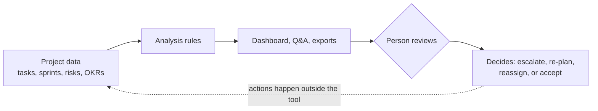

# Project Overview

Monday Smart PMO Agent is a local decision-support tool for **project planning and
delivery**. It reads Monday-style project data and turns it into a delivery picture that a
person can review: health, sprint progress, risks, team load, and alignment with
objectives (OKRs).

---

## The Problem

Delivery problems usually appear in the data before anyone names them. A sprint falls
behind plan, a blocked task holds up a business objective, or one person ends up carrying
much of the open work. In a busy board these signals are scattered across statuses, owners,
due dates, and separate risk and OKR lists. They are easy to miss until they become late
surprises.

## Purpose

The project brings those signals together in one place, so the people planning and
monitoring the work can:

- see overall delivery health at a glance,
- spot blockers and risks early,
- check whether the team's load is balanced,
- check whether current work supports the stated objectives,
- prepare status summaries and retrospective discussions faster.

It is a **support tool**. It points things out and suggests follow-ups; it never decides,
approves, or changes anything.

## Value

- **One view instead of many**: health, sprint, risk, capacity, and OKR signals sit side by side.
- **Transparent results**: every score comes from a fixed, documented rule, so a reviewer can see why it was produced.
- **Earlier conversations**: blocked work that threatens an objective is flagged before the objective visibly fails.
- **Low setup cost**: it runs offline on demo data, with no account or API key.

## Capabilities

| Capability | What it shows | Status |
|------------|---------------|--------|
| Project health | Green / Yellow / Red score, task status counts, overdue tasks, active blockers | Working |
| Sprint monitoring | Progress vs. plan, sprint health, carryover risk, owners with repeated blockers, retrospective talking points | Working |
| Risk visibility | Open risks from the risk register, sorted by severity, with mitigations and affected OKRs | Working |
| Team load | Active tasks and points per person, overload and workload-concentration flags | Working |
| OKR alignment | Key-result progress, at-risk objectives, share of work with no OKR link, at-risk OKRs with blocked contributing work | Working |
| Q&A assistant | Answers questions such as "What should I focus on this week?" from the analysis results | Working (rule-based); OpenAI optional |
| Exports | Health report (`.md`), sprint summary (`.csv`), risk register (`.csv`) | Working |
| Live Monday data | Reading a real Monday workspace | Placeholder only, not implemented |

All project data is fictional demo data. See
[Architecture](ARCHITECTURE.md#integration-status) for the integration status.

## Workflow

1. **Load**: the app reads tasks, sprints, risks, and OKRs through a data adapter.
2. **Analyse**: rule-based modules calculate health, sprint status, team load, and OKR alignment.
3. **Present**: results appear in seven tabs; the Q&A assistant can explain them in plain language.
4. **Review**: a person reads the signals and decides what to do. The tool takes no action.

## Practical Example

The bundled demo data describes a fictional company, TechCo, building a product called
FlowHQ: 2 boards, 40 tasks, 4 sprints (Sprint 7 active), 8 risks, 4 OKRs, and 8 team
members.

Opening the app shows:

| Signal | Result in the demo |
|--------|--------------------|
| Project health | **Yellow**: Sprint 7 is 37% complete (22 of 60 points); 5 tasks are stuck or blocked |
| Sprint health | **At Risk**: progress is below 50% of plan |
| Risk level | **Critical**: top risk is OKR-2 (Reduce Churn), whose key dependency has been blocked for 3 days |
| OKRs | OKR-1 is At Risk and OKR-2 is Off Track; both have blocked or stuck contributing tasks |
| Unaligned work | About 17% of active tasks have no OKR link |
| Team load | Dan K. and Lior H. have 5 or more active tasks each and are flagged as overloaded |

A reviewer might then ask the assistant "What should I focus on this week?", export the
health report, and decide whether to escalate the blocked schema approval behind OKR-2 or
move work away from the overloaded team members. Those decisions remain with the reviewer.

Overdue counts are calculated against today's date. All demo due dates fall in June–July
2026, so the overdue number keeps rising as time passes.

For screenshots and a step-by-step demo, see [Demo and Operations](DEMO_AND_OPERATIONS.md).
